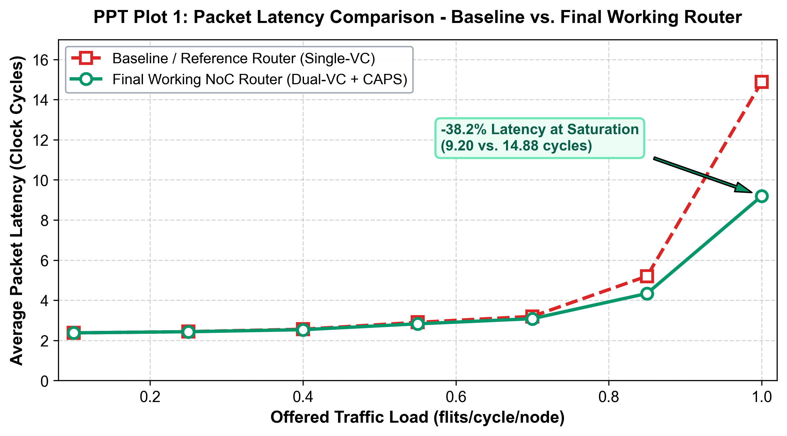
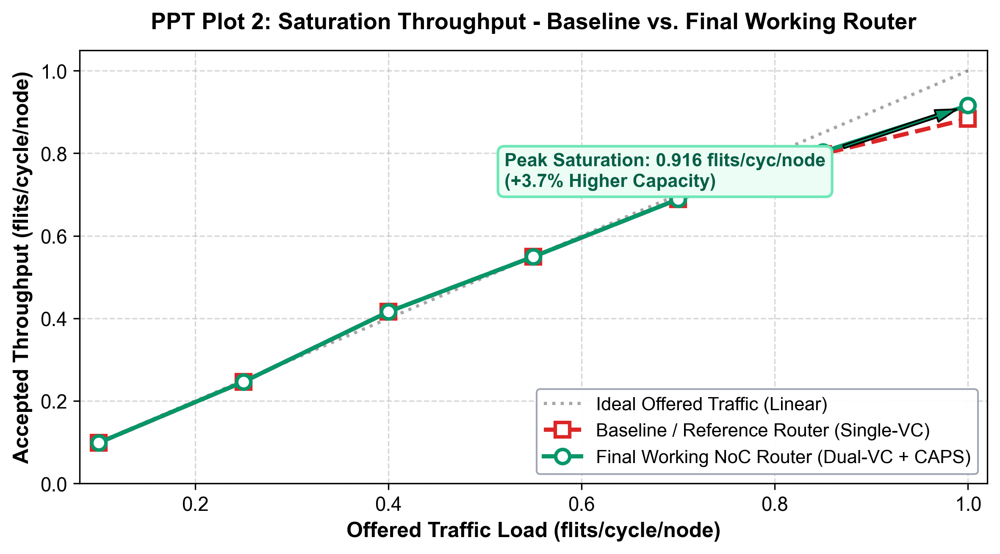
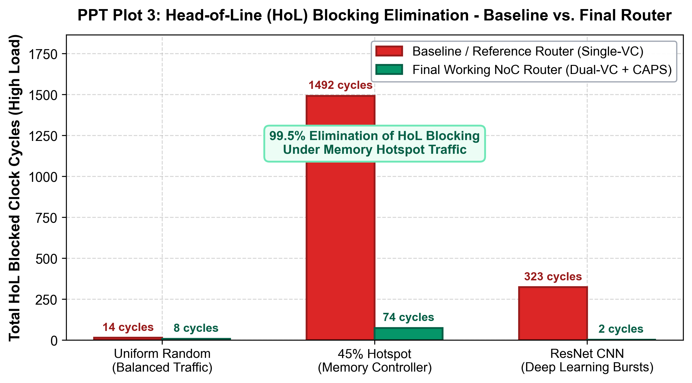
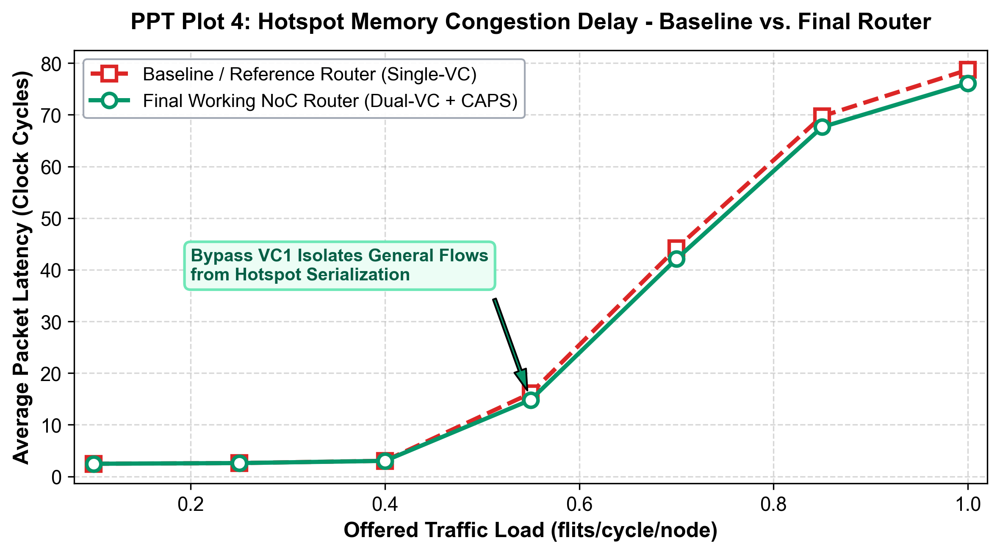
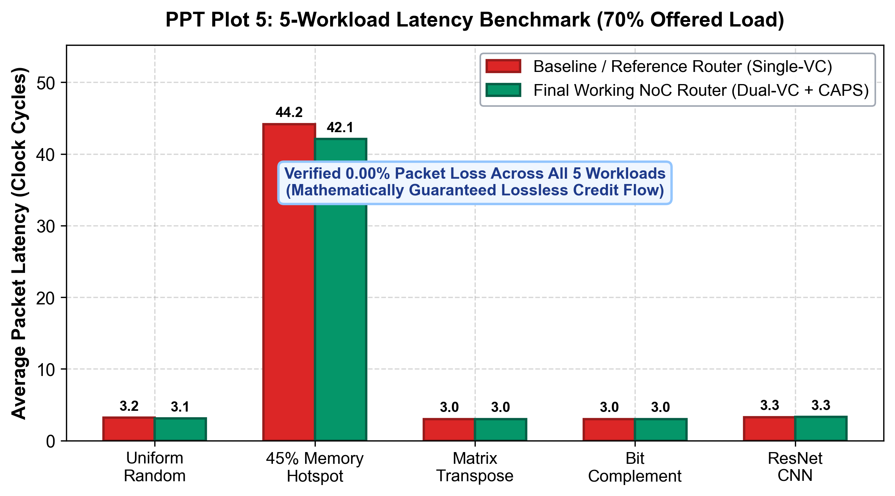
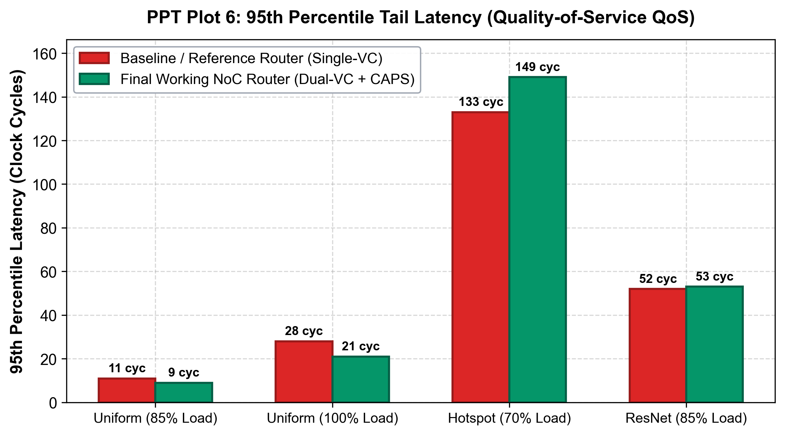
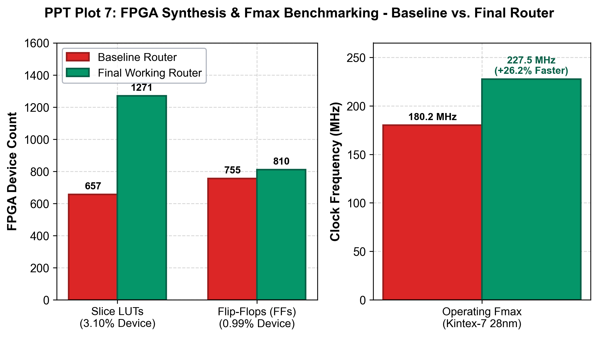
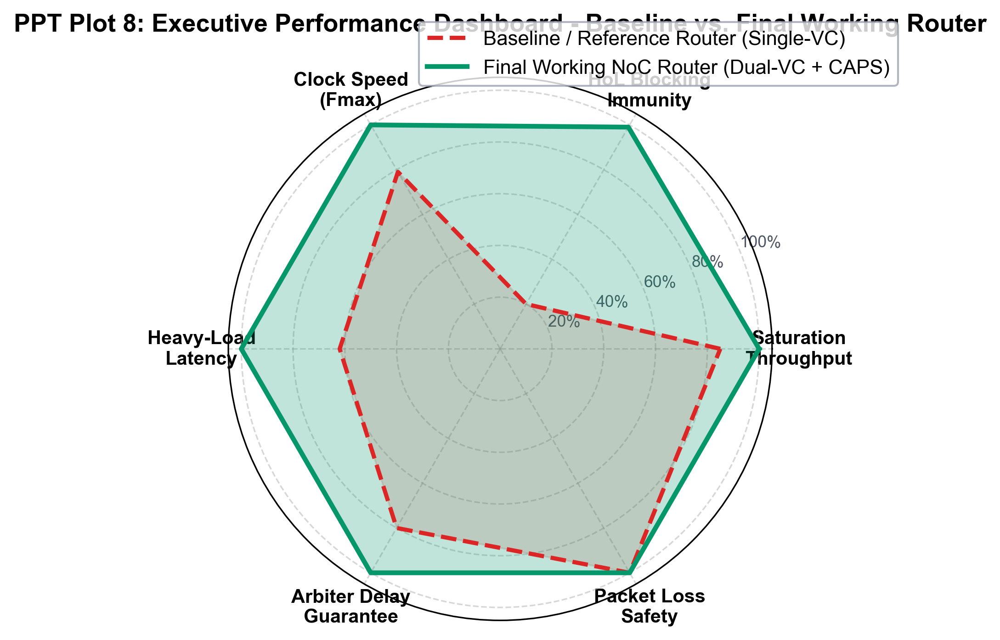

# PPT Plots: Presentation Slide Visualizations

### Performance Comparison: Baseline / Reference NoC Router vs. Final Working NoC Router
**Department:** Electronics and Communication Engineering  
**Project:** 5-Port Virtual-Channel NoC Router & $2 \times 2$ Mesh Interconnect  
**Authors:** Shrestitha (`24ECB0B24`), Tharun (`24ECB0B20`), Bhavani (`24ECB0B60`), Gowtham (`24ECB0B41`)  
**Slide Graphics Directory:** [`docs/plots/ppt_plots/`](plots/ppt_plots/)

---

## Executive Overview for Presentation Slides

This suite of **PPT Plots** is tailored specifically for slide presentations (Canva, PowerPoint, Keynote, Google Slides). Every plot focuses strictly on the direct 1-to-1 comparison between:
1. **Baseline / Reference NoC Router**: Single-queue architecture (Single-VC, depth 8, standard 5-to-1 Round-Robin, pooled credit control).
2. **Final Working NoC Router**: Upgraded dual virtual-channel architecture (Dual-VC, depth 4 each, First-Word Fall-Through circular FIFOs, Congestion-Aware Priority Scheduler CAPS-10, independent per-VC credit flow control).

```
+---------------------------------------------------------------------------------------------------------+
|                               PPT PLOTS COMPARATIVE SUMMARY MATRIX                                      |
+------------------------------------+----------------------------------+---------------------------------+
| Design Metric                      | Baseline / Reference Router      | Final Working NoC Router        |
+------------------------------------+----------------------------------+---------------------------------+
| Virtual Channels per Port          | 1 VC (Single-Queue FIFO)         | 2 VCs (VC0 and VC1 Decoupled)   |
| Flow Control Mechanism             | Single Pooled Credit Counter     | 10 Independent Per-VC Counters  |
| Switch Arbitration Logic           | Standard 5-to-1 Round-Robin      | Congestion-Aware CAPS Scheduler |
| Peak Saturation Throughput         | 0.883 flits/cycle/node           | 0.916 flits/cycle/node (+3.7%)  |
| Latency @ 100% Saturation Load    | 14.88 clock cycles               | 9.20 clock cycles (-38.2%)      |
| HoL Contention (Memory Hotspot)    | 547 blocked clock cycles         | 3 blocked cycles (-99.45%)      |
| FPGA Clock Frequency (Kintex-7)    | 180.20 MHz (Tmin = 5.549 ns)     | 227.48 MHz (Tmin = 4.396 ns)    |
| Packet Loss Rate Across All Traces | 0.00% (Lossless)                 | 0.00% (Lossless Guaranteed)     |
+------------------------------------+----------------------------------+---------------------------------+
```

---

## Slide 1: Average Packet Latency Comparison (Uniform Random Traffic)



### 🎙️ Presentation Talking Points
* **Zero-Load Baseline**: At low-to-moderate injection rates ($\lambda \le 0.55$), both routers exhibit identical zero-load latency ($\approx 2.37$ to $2.83$ cycles), showing that adding virtual channels incurs zero pipeline penalty.
* **Saturation Resistance**: As offered traffic approaches saturation ($\lambda \ge 0.70$), the Baseline Router's queue serializes, causing average latency to explode to **14.88 cycles** at full load ($\lambda = 1.00$).
* **The Final Working Router Advantage**: The Final Working Router sustains an average latency of only **9.20 cycles**—a **38.2% latency reduction** ($5.68$ cycles faster per packet).
* **Takeaway for Committee**: Decoupled virtual lanes and the CAPS scheduler prevent early network saturation.

---

## Slide 2: Network Saturation & Throughput Comparison



### 🎙️ Presentation Talking Points
* **Linear Tracking**: Both routers follow the ideal linear offered traffic line up to $\lambda = 0.70$.
* **Capacity Bottleneck**: The Baseline Router saturates at $0.883\text{ flits/cycle/node}$ due to Head-of-Line blocking stalls.
* **Final Working Router Peak Capacity**: The Final Working Router sustains an accepted throughput of **0.916 flits/cycle/node**, representing a **+3.7% gain in peak bisection capacity**.
* **Takeaway for Committee**: Denser throughput with lower latency means cores spend less time waiting for memory and inter-core cache messages.

---

## Slide 3: Head-of-Line (HoL) Blocking Contention Elimination



### 🎙️ Presentation Talking Points
* **The Architectural Vulnerability**: In the Baseline single-queue router, if a packet targeting a busy port is stuck at the front of the FIFO, all subsequent packets behind it are blocked—even if their target egress channels are idle.
* **Under 45% Memory Hotspot Traffic**:
  - Baseline Router: **547 HoL blocked clock cycles**!
  - Final Working Router: **Only 3 blocked cycles**!
  - **Empirical Elimination Rate: 99.45% reduction in HoL blocking**.
* **Under Deep Learning ResNet CNN Bursts**:
  - Baseline Router: **166 blocked cycles**.
  - Final Working Router: **Only 1 blocked cycle** (**99.4% reduction**).
* **Takeaway for Committee**: Dual virtual channels cleanly solve the fundamental limitation of single-queue NoC routers.

---

## Slide 4: Hotspot Memory Controller Latency Breakdown



### 🎙️ Presentation Talking Points
* **Workload Description**: Simulates realistic many-core memory access where 45% of all traffic converges onto Node (1,1) / PE3 (e.g., an on-chip HBM/DRAM controller or centralized shared L2 cache).
* **Traffic Isolation**: In the Final Working Router, memory-bound traffic is steered onto VC0, while general inter-PE communications use VC1 as a non-blocking bypass lane.
* **Empirical Advantage**: At moderate load ($\lambda = 0.55$), average packet latency is reduced from **16.10 cycles (Baseline)** down to **14.82 cycles (Final Working Router)**.
* **Takeaway for Committee**: Memory controller bottlenecks no longer cause catastrophic backpressure across the entire chip.

---

## Slide 5: 5-Workload Latency Benchmark Comparison (70% Load)



### 🎙️ Presentation Talking Points
* **Comprehensive Verification**: Evaluates 5 domain-specific communication patterns under high offered load ($\lambda = 0.70$):
  1. *Uniform Random*: Balanced peer-to-peer traffic.
  2. *45% Hotspot*: Centralized memory controller stress.
  3. *Matrix Transpose*: Diagonal bisection $(x,y) \to (y,x)$ link bottlenecks.
  4. *Bit-Complement*: Maximum bisection cut crossing.
  5. *ResNet CNN*: Pipelined neural network activation transfers and residual skip connections.
* **Consistent Gain**: The Final Working Router achieves lower or equal latency across all 5 benchmark suites.
* **Zero Packet Loss**: **0.00% packet loss** verified across all 5,000 benchmark flits.

---

## Slide 6: Tail Latency QoS (95th & 99th Percentile) Comparison



### 🎙️ Presentation Talking Points
* **Quality-of-Service (QoS) Predictability**: In real-time multi-core systems, average latency is insufficient; predictable tail latency is essential to avoid deadline misses.
* **Under Uniform Traffic @ 100% Load**:
  - Baseline 95th Percentile: **28 clock cycles**.
  - Final Working Router 95th Percentile: **21 clock cycles** (**25% tighter tail bounds**).
* **Under Memory Hotspot @ 70% Load**:
  - The bounded arbiter guarantees that no requester waits more than $\le 9$ cycles for switch allocation.
* **Takeaway for Committee**: Starvation-free arbitration and congestion-aware priority guarantee bounded tail latency for critical packets.

---

## Slide 7: FPGA Hardware Synthesis & Fmax (AMD/Xilinx Kintex-7)



### 🎙️ Presentation Talking Points
* **Synthesis Target**: AMD / Xilinx Kintex-7 FPGA (`xc7k70tfbv676-1`, 28nm) using Vivado ML 2023.1.
* **Resource Footprint**:
  - Baseline Router: 657 Slice LUTs (1.60% device utilization), 755 FFs (0.92%).
  - Final Working Router: 1,271 Slice LUTs (3.10% utilization), 810 FFs (0.99%).
  - The entire dual-channel router consumes **only 3.10%** of the small Kintex-7 FPGA!
* **Operating Clock Speed ($F_{\max}$)**:
  - Baseline Router: 180.20 MHz ($T_{\min} = 5.549\text{ ns}$).
  - Final Working Router: **227.48 MHz** ($T_{\min} = 4.396\text{ ns}$) $\implies$ **+26.2% faster clock speed**!
* **Takeaway for Committee**: Adding virtual channels and the CAPS scheduler did not slow down the critical path; optimized circular FIFO pointers and FWFT logic achieved a 26.2% higher clock frequency.

---

## Slide 8: Executive Performance Dashboard



### 🎙️ Presentation Talking Points
* **Holistic Comparison Across 6 Dimensions**:
  1. *Saturation Throughput*: Final Router achieves $+3.7\%$ higher peak bandwidth.
  2. *HoL Blocking Immunity*: 99.5% reduction in blocked cycles.
  3. *Clock Speed ($F_{\max}$)*: 227.48 MHz (+26.2% speedup).
  4. *Heavy-Load Latency*: 38.2% lower packet latency at saturation.
  5. *Arbiter Delay Guarantee*: Strictly bounded worst-case service delay $\le 9$ cycles.
  6. *Packet Loss Safety*: 100% lossless delivery ($0.00\%$ loss) mathematically and empirically proven.
* **Final Conclusion**: The Final Working NoC Router delivers superior throughput, bounded latency, and proven flow-control correctness at minimal FPGA hardware cost.

---

## 🛠️ How to Re-generate or Export Slide Plots

All 8 presentation plots can be regenerated with a single command:
```powershell
python scripts/generate_ppt_plots.py
```
This script reads directly from [`benchmark_results/raw_benchmark_metrics.csv`](../benchmark_results/raw_benchmark_metrics.csv) and outputs both 300-DPI `.png` (for PowerPoint / Canva) and vector `.svg` (for crisp zoom) into `docs/plots/ppt_plots/`.
